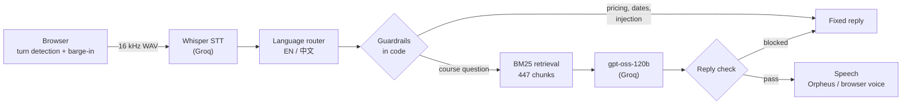

# The AI-First Leader: website and bilingual voice agent

The site for [The AI-First Leader](https://sasistician.com), an AI program for leaders. It includes
a **live bilingual (English and Mandarin) RAG voice agent** that answers questions about the
programs out loud.

**Try it:** [sasistician.com/?talk=1](https://sasistician.com/?talk=1). Click to talk, and ask in
English or 中文.

---

## The voice agent at a glance

One turn is one HTTP request to one Vercel function, using about **1 s of server time**.



| Stage | Where | What it does |
|---|---|---|
| Turn detection | `src/lib/voice.ts` | Energy-based voice activity detection in the browser, with an adaptive noise floor and pre-roll. 0.9 s of silence ends a turn, and you can interrupt the agent mid-reply (barge-in). |
| Speech-to-text | `api/_lib/providers.js` | Whisper large-v3-turbo on Groq, prompted with the course vocabulary ("Claude Code", "MCP", "sub-agents"…). |
| Language router | `api/_lib/router.js` | Picks the reply language (English or Mandarin) for the session. |
| Guardrails | `api/_lib/policy.js` | Pricing, date and prompt-injection phrasings are matched **before the model** and get fixed replies. Dates come only from a schedule constant, never from the model. |
| Retrieval | `api/_lib/kb.js` | BM25 over **447 chunks from 25 allowlisted sources**, in about 5 ms. Uses bilingual query expansion, Chinese character n-grams, an acronym boost, "week four" / 第四周 parsing, a preference for the session language, and at most two chunks per source. |
| Answer | `api/_lib/agent.js` | `openai/gpt-oss-120b` on Groq, at low reasoning effort, prompted to stay under 45 words. Questions with almost no keyword overlap skip the model. |
| Reply check | `api/_lib/policy.js` | Rejects any reply that states currency amounts, years, dates or "guarantee", in English or Chinese, and returns a safe fixed reply instead. |
| Speech | `api/_lib/tts.js` | Orpheus on Groq for English, in requests of up to 200 characters synthesised in parallel. Mandarin, and any TTS failure, fall back to the browser's own voice. |

## Design choices

- **No vector database.** At 447 chunks, BM25 is fast (about 5 ms) and fully debuggable, so you
  can see exactly why a chunk was retrieved.
- **Guardrails in code, not just the prompt.** The model has no tools and no secrets, only public
  course text. Risky topics never reach it, and every reply is checked before it is spoken.
- **Allowlisted knowledge base.** Only files listed in `kb/sources.json` are indexed (`npm run kb`
  builds `api/_data/kb.js`). Personal files, `.env` files and internal planning docs are never
  indexed.
- **Stateless and private.** The browser sends only the last two exchanges and the session
  language. The server keeps no profiles and stores no audio. Per-visitor rate limits are applied.
- **No LiveKit, no streaming.** Latency is the sum of the stages, which keeps the system simple
  to run and reason about.

## Evals and tests

- **30 eval cases** (`evals/`): **19 core and 11 red-team**. They check policy, reply language,
  the retrieved source, forbidden phrases and the word cap.
  - `npm run evals` runs in mock mode at no cost.
  - `GROQ_API_KEY=... npm run evals -- --live` adds the model checks.
- **20 unit tests** (`tests/`): `npm run test:agent`.
- **Every production bug becomes a regression case.** Add an eval case before changing the
  prompt, the guardrails or the retrieval.
- Not yet covered: LLM-as-judge or faithfulness scoring. The evals are regression tests.

## Also on the site

- **`/agentic`** shows a personalised ad built by a multi-agent system (strategist, copywriter,
  compliance and translator agents), with a deterministic claim check before anything ships. It is
  exported from a separate project.

## Run it locally

```bash
npm install
npm run kb          # rebuild the knowledge base from kb/sources.json
npm run dev:api     # voice-agent API on port 3001
npm run dev         # site (Vite proxies /api)
```

Put `GROQ_API_KEY` in `.env.local` (git-ignored). Without it, the API runs in **mock mode**: you
can only type questions, and answers quote the best-matching excerpt.

**Stack:** Vite, React 18, TypeScript, Tailwind CSS, Vercel functions, and Groq (Whisper,
gpt-oss-120b, Orpheus).

## Credits

The voice agent is modelled on the Aurora workshop agent from Hamza Farooq's multi-agent course
(Assignment 2), rebuilt without LiveKit.

## Author

**Bilal Farooq**: [sasistician.com](https://sasistician.com) ·
[LinkedIn](https://www.linkedin.com/in/sasistician/)
